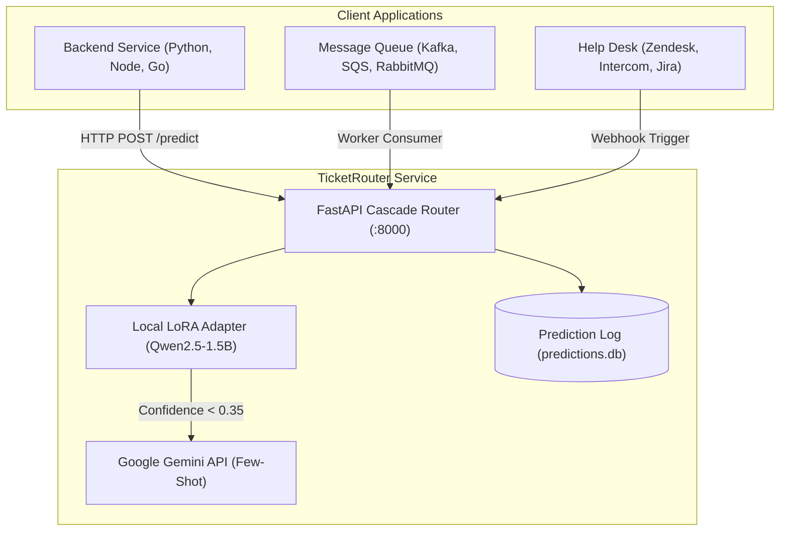

# TicketRouter: Enterprise Service Integration Guide

This guide details how to integrate **TicketRouter** seamlessly into existing customer support workflows, backend services, event-driven message buses, and SaaS help desk platforms (Zendesk, Intercom, Freshdesk, Jira Service Management).

---

## 📋 API Specification & Contract

TicketRouter exposes a lightweight, OpenAPI-compliant REST service running on FastAPI.

### Endpoint: `/predict`
- **Method**: `POST`
- **Path**: `/predict`
- **Headers**: `Content-Type: application/json`

#### Request Schema:
```json
{
  "text": "Why was my debit card payment declined at the supermarket?"
}
```

#### Response Schema:
```json
{
  "intent": "declined_card_payment",
  "confidence": 0.8948,
  "latency_ms": 13.44,
  "route": "model",
  "low_confidence": false
}
```

| Field | Type | Description |
| :--- | :--- | :--- |
| `intent` | `string` | One of the 77 standardized banking intent categories. |
| `confidence` | `float` | Calibrated model confidence score ($0.0 \le \text{confidence} \le 1.0$). |
| `latency_ms` | `float` | Server-side execution time in milliseconds. |
| `route` | `string` | Resolution tier: `"model"` (local SLM), `"gemini_fallback"`, or `"model_low_confidence"`. |
| `low_confidence` | `boolean` | Flag indicating whether the prediction fell below the confidence threshold ($\tau = 0.35$). |

### Operational Endpoints:
- **`GET /health`**: Returns system readiness, uptime, and loaded model metadata (used for Kubernetes liveness/readiness probes).
- **`GET /metrics`**: Exposes Prometheus metrics including request counts by route, average latency, and average confidence.

---

## 🛠️ Integration Architecture Patterns



---

### Pattern 1: Synchronous REST / Webhook Integration

Direct HTTP integration is suitable for synchronous API gateways, microservices, and backend dispatchers.

#### Python (Async with `httpx`)
```python
import httpx

TICKETROUTER_URL = "http://ticketrouter-service.default.svc.cluster.local:80/predict"


async def route_ticket(ticket_text: str) -> dict:
    async with httpx.AsyncClient(timeout=3.0) as client:
        response = await client.post(TICKETROUTER_URL, json={"text": ticket_text})
        response.raise_for_status()
        data = response.json()

    intent = data["intent"]
    confidence = data["confidence"]

    # Priority routing dispatch
    if intent in ["lost_or_stolen_card", "card_compromised"]:
        await dispatch_fraud_escalation(ticket_text)
    elif intent in ["declined_card_payment", "transfer_timing"]:
        await dispatch_automated_faq(ticket_text, intent)
    else:
        await assign_agent_queue(ticket_text, intent)

    return data
```

#### TypeScript / Node.js (`fetch`)
```typescript
interface PredictionResponse {
  intent: string;
  confidence: number;
  latency_ms: number;
  route: "model" | "gemini_fallback" | "model_low_confidence";
  low_confidence: boolean;
}

const TICKETROUTER_URL = process.env.TICKETROUTER_URL || "http://localhost:8000/predict";

export async function classifyTicket(text: string): Promise<PredictionResponse> {
  const response = await fetch(TICKETROUTER_URL, {
    method: "POST",
    headers: { "Content-Type": "application/json" },
    body: JSON.stringify({ text }),
  });

  if (!response.ok) {
    throw new Error(`TicketRouter error: ${response.statusText}`);
  }

  return (await response.json()) as PredictionResponse;
}
```

#### Go (`net/http`)
```go
package main

import (
	"bytes"
	"encoding/json"
	"fmt"
	"net/http"
	"time"
)

type PredictRequest struct {
	Text string `json:"text"`
}

type PredictResponse struct {
	Intent        string  `json:"intent"`
	Confidence    float64 `json:"confidence"`
	LatencyMs     float64 `json:"latency_ms"`
	Route         string  `json:"route"`
	LowConfidence bool    `json:"low_confidence"`
}

func ClassifyTicket(url, text string) (*PredictResponse, error) {
	payload, _ := json.Marshal(PredictRequest{Text: text})
	client := &http.Client{Timeout: 2 * time.Second}
	
	resp, err := client.Post(url, "application/json", bytes.NewBuffer(payload))
	if err != nil {
		return nil, err
	}
	defer resp.Body.Close()

	var result PredictResponse
	if err := json.NewDecoder(resp.Body).Decode(&result); err != nil {
		return nil, err
	}
	return &result, nil
}
```

---

### Pattern 2: Asynchronous Event-Driven Pipeline (Kafka / SQS / PubSub)

For high-throughput systems processing hundreds of thousands of tickets daily, consume tickets asynchronously from an incoming queue and publish enriched routing events to destination topics.

```python
import json
import logging
from kafka import KafkaConsumer, KafkaProducer
import requests

ROUTER_URL = "http://localhost:8000/predict"

consumer = KafkaConsumer(
    "tickets.incoming",
    bootstrap_servers=["localhost:9092"],
    value_deserializer=lambda m: json.loads(m.decode("utf-8")),
    group_id="ticketrouter-workers",
)
producer = KafkaProducer(
    bootstrap_servers=["localhost:9092"], value_serializer=lambda m: json.dumps(m).encode("utf-8")
)

for message in consumer:
    ticket = message.value
    ticket_id = ticket.get("id")
    body = ticket.get("description", "")

    # Call TicketRouter
    try:
        res = requests.post(ROUTER_URL, json={"text": body}, timeout=2.0)
        prediction = res.json()

        # Enrich ticket event
        ticket["classified_intent"] = prediction["intent"]
        ticket["routing_confidence"] = prediction["confidence"]
        ticket["routing_tier"] = prediction["route"]

        # Fan-out to domain-specific topics
        target_topic = f"tickets.routed.{prediction['intent']}"
        producer.send(target_topic, value=ticket)
        logging.info(f"Routed ticket {ticket_id} -> {target_topic}")

    except Exception as e:
        logging.error(f"Failed to route ticket {ticket_id}: {e}")
        producer.send("tickets.dead_letter", value=ticket)
```

---

### Pattern 3: In-Process Python SDK (Zero Network Latency)

For native Python services that require sub-millisecond execution and zero network overhead, load the 70 MB LoRA adapter directly into memory using Hugging Face `transformers` and `peft`:

```python
import torch
from transformers import AutoModelForCausalLM, AutoTokenizer
from peft import PeftModel


class InProcessTicketRouter:
    def __init__(self, adapter_dir: str = "models/qwen_lora_adapter"):
        self.tokenizer = AutoTokenizer.from_pretrained(adapter_dir)
        base = AutoModelForCausalLM.from_pretrained(
            "Qwen/Qwen2.5-1.5B-Instruct", torch_dtype=torch.float16, device_map="auto"
        )
        self.model = PeftModel.from_pretrained(base, adapter_dir)
        self.model.eval()

    def predict(self, text: str) -> str:
        messages = [
            {
                "role": "system",
                "content": (
                    "You are an enterprise banking query intent classifier. "
                    "Classify the customer inquiry into exactly one of the 77 standard intents. "
                    "Output ONLY the exact intent label."
                ),
            },
            {"role": "user", "content": f"Query: {text}"},
        ]
        prompt = self.tokenizer.apply_chat_template(
            messages, tokenize=False, add_generation_prompt=True
        )
        inputs = self.tokenizer(prompt, return_tensors="pt").to(self.model.device)

        with torch.no_grad():
            outputs = self.model.generate(**inputs, max_new_tokens=15, do_sample=False)
            intent = self.tokenizer.decode(
                outputs[0][inputs.input_ids.shape[1] :], skip_special_tokens=True
            ).strip()

        return intent


# Usage
router = InProcessTicketRouter()
print(router.predict("My card is stuck in the ATM machine"))
# Output: card_arrival / atm_support
```

---

### Pattern 4: SaaS Customer Support Integrations (Zendesk / Intercom / Jira)

#### Zendesk Webhook Integration:
1. Navigate to **Zendesk Admin Center** $\rightarrow$ **Apps and integrations** $\rightarrow$ **Webhooks**.
2. Click **Create webhook**:
   - **Name**: `TicketRouter Intent Classifier`
   - **Endpoint URL**: `https://<YOUR_INGRESS_DOMAIN>/predict`
   - **Request method**: `POST`
   - **Request format**: `JSON`
3. Create a **Trigger**:
   - **Conditions**: `Ticket is Created`
   - **Action**: `Notify active webhook` $\rightarrow$ `TicketRouter Intent Classifier`
   - **JSON Body**:
     ```json
     {
       "text": "{{ticket.description}}"
     }
     ```
4. Configure an automated routing action based on the webhook response tag to assign the ticket directly to specialized agent queues (Fraud, Cards, Accounts, Wire Transfers).

#### Intercom Webhook Integration:
1. In the **Intercom Developer Hub**, configure a Webhook subscription for `conversation.user.created`.
2. Direct the webhook to an intermediary serverless function or API gateway that parses the initial customer message, calls `POST /predict`, and updates the conversation custom attributes with `intent` and `routing_confidence`.

---

## 🛡️ Production Best Practices & Resilience

1. **Kubernetes Internal DNS**:
   - In a Kubernetes cluster, address the service using internal DNS:  
     `http://ticketrouter-service.default.svc.cluster.local:80/predict`
2. **Client-Side Timeouts**:
   - Local SLM inference takes $5\text{--}15\text{ ms}$. If Gemini fallback triggers, network latency can take up to $150\text{--}400\text{ ms}$. Set client timeouts to **2.0 seconds** to accommodate fallback calls without hanging.
3. **Graceful Fallback Handling**:
   - If TicketRouter returns `low_confidence: true` or HTTP 503, configure the client to assign the ticket to an unclassified "Triage Review" queue rather than dropping it.
4. **Monitoring Drift**:
   - Regularly poll `/metrics` with Prometheus to track the `ticketrouter_requests_total{route="gemini_fallback"}` counter. An increasing fallback rate is a leading indicator of live data drift.
