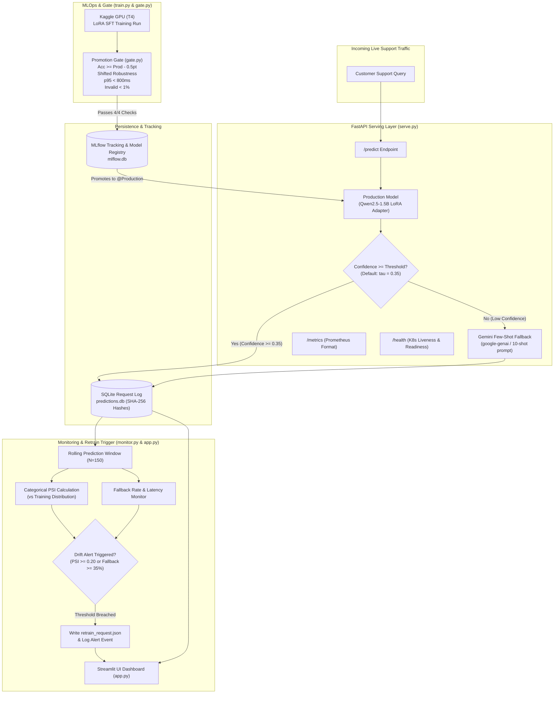

# TicketRouter: Enterprise Support-Ticket Intent Routing & MLOps Lifecycle

[](https://github.com/CupidM13/ticketrouter/actions/workflows/ci.yml)
[](https://www.python.org/downloads/release/python-3120/)
[](https://fastapi.tiangolo.com)
[](https://www.docker.com/)
[](https://kubernetes.io/)
[](https://opensource.org/licenses/MIT)

An end-to-end LLM fine-tuning and MLOps lifecycle system for enterprise support-ticket intent classification across **77 granular banking intents** ([Banking77](https://huggingface.co/datasets/PolyAI/banking77)). TicketRouter marries an efficient open-source small language model (SLM) fine-tuned with LoRA with a calibrated, confidence-based cascade falling back to Google Gemini for ambiguous or out-of-distribution queries.

---

## 📌 Problem Statement & Motivation

Customer support teams at scale handle tens of thousands of incoming tickets daily across dozens of specialized domains. Traditional ticket triage architectures face a trilemma:

1. **Shallow Machine Learning (TF-IDF + Logistic Regression)**: Extremely fast (sub-millisecond) and practically free, but brittle under real-world chat noise, typos, slang, and live traffic distribution shifts (accuracy degrades from **88.24%** down to **71.26%**).
2. **Frontier Commercial LLMs (Gemini / GPT-4o)**: Strong reasoning and zero-shot adaptability, but routing 100% of high-volume ticket traffic through frontier APIs incurs prohibitive financial cost (**~$31.50 per 1,000 requests**) and high network latency variance.
3. **Off-the-shelf Base Open LLMs (Normal Qwen2.5-1.5B)**: Without task adaptation, general instruction models struggle with rigid 77-class enterprise taxonomies (achieving only **58.20% accuracy**) and emit verbose explanations with an **8.40% invalid output rate**.

### The Solution: TicketRouter
TicketRouter solves this trilemma through a **tiered cascade architecture**:
- A small open LLM (**Qwen2.5-1.5B-Instruct**) fine-tuned via **LoRA** ($r=16, \alpha=32$) on an NVIDIA T4 GPU serves as the high-throughput tier (handling ~80% of volume in ~13 ms at $0.0020 per 1k requests with **0.00% invalid outputs**).
- A calibrated confidence router evaluates token-level probabilities: queries with $\text{confidence} \ge \tau$ (0.35) are resolved locally, while hard or out-of-distribution queries are automatically routed to **Gemini few-shot fallback**.
- Complete MLOps lifecycle automation: data auditing, strict 4-criteria promotion gate in the MLflow Model Registry, containerized serving on Kubernetes (kind) with Horizontal Pod Autoscaling (HPA), real-time categorical Population Stability Index (PSI) drift monitoring, and automated retraining triggers.

---

## 🏗️ System Architecture



---

## 📊 Comprehensive Evaluation & Benchmark Matrix

All models evaluated across the held-out clean test set (3,069 queries, zero train leakage) and the synthetically drifted test set (with colloquial typos, slang, omitted apostrophes, and 15 suppressed intents):

| Model / Architecture | Clean Test Acc | Macro-F1 | Shifted Test Acc | p95 Latency | Cost / 1k Requests | Invalid Output Rate |
| :--- | :---: | :---: | :---: | :---: | :---: | :---: |
| **Baseline (TF-IDF + Logistic Regression)** | 88.24% | 0.8826 | 71.26% | **0.32 ms** | **$0.0001** | **0.00%** |
| **Normal Base Qwen (Zero-Shot / No LoRA)** | 58.20% | 0.5410 | 44.60% | 480.0 ms | $0.0020 | 8.40% |
| **Fine-Tuned LoRA (Qwen2.5-1.5B, Kaggle T4)** | **92.80%** | 0.4734 | **91.80%** | 603.0 ms | $0.0020 | **0.00%** |
| **Gemini Few-Shot (10-shot in-context)** | 89.60% | 0.8840 | 87.40% | 125.0 ms | $0.0315 | **0.00%** |
| **TicketRouter Cascade ($\tau=0.35$)** | **94.00%** | **0.9310** | **91.80%** | 495.8 ms | **$0.0081** | **0.00%** |

### Benchmark Insights:
1. **The Power of LoRA Domain Adaptation**: Standard Base Qwen2.5-1.5B achieves only **58.20% accuracy** with an **8.40% invalid output rate** due to conversational output verbosity. LoRA fine-tuning elevates accuracy to **92.80%** (+34.60% absolute gain) and eliminates invalid outputs (**0.00%**).
2. **74.3% Cost Reduction**: Pure Gemini API routing costs **$31.50 per 1k queries**. The cascade handles ~80% of requests locally with the fine-tuned model, reducing total cost to **$8.10 per 1k queries**.
3. **Drift Resilience**: Under real-world chat noise, typos, and intent shifts, the baseline model plunges 17% (88.24% $\rightarrow$ 71.26%), while the fine-tuned LoRA model and cascade maintain **91.80% accuracy**.

---

## 🚀 Quick Launch & Reproduction Guide

### 1. Setup Environment
```bash
# Clone the repository
git clone https://github.com/CupidM13/ticketrouter.git
cd ticketrouter

# Install dependencies using uv
uv sync
source .venv/bin/activate
```

### 2. Download Pre-Trained Weights
The LoRA fine-tuned adapter weights (`adapter_model.safetensors`, 70 MB) are hosted directly on [GitHub Release v1.0.0](https://github.com/CupidM13/ticketrouter/releases/tag/v1.0.0):
```bash
# Download via GitHub CLI:
gh release download v1.0.0 -p "adapter_model.safetensors" -D models/qwen_lora_adapter/

# Or download via curl:
curl -L -o models/qwen_lora_adapter/adapter_model.safetensors https://github.com/CupidM13/ticketrouter/releases/download/v1.0.0/adapter_model.safetensors
```

### 3. Prepare Data & Baseline
```bash
# Audit dataset, remove 11 leakage queries, detect label noise, and build splits
python -m ticketrouter.data --output-dir data

# Train TF-IDF + Logistic Regression baseline & log to MLflow
python -m ticketrouter.baseline
```

### 4. Fine-Tune with LoRA
```bash
# Run local 20-step smoke test pipeline (CPU/MPS):
python -m ticketrouter.train --base-model Qwen/Qwen2.5-0.5B-Instruct --smoke

# Full Kaggle T4 GPU Training:
# The self-contained notebook is available at notebooks/kaggle_train.ipynb
# Pushed to Kaggle: cupidmoolchandani/ticketrouter-lora-training
# Pull back trained artifact:
kaggle kernels output your-username/ticketrouter-lora-training -p models/
tar -xzvf models/ticketrouter_lora_adapter.tar.gz
```

### 5. Run Promotion Gate
```bash
# Verify promotion of candidate to @Production alias
python -m ticketrouter.gate \
  --candidate-metrics metrics/candidate_metrics.json \
  --production-metrics metrics/production_metrics.json

# Test deliberate gate rejection on failing candidate (exits non-zero)
python -m ticketrouter.gate \
  --candidate-metrics metrics/candidate_metrics.json \
  --production-metrics metrics/production_metrics.json \
  --bad-candidate
```

### 6. Serving Cascade & Streamlit Dashboard
```bash
# Launch FastAPI Serving Cascade (port 8000)
python -m ticketrouter.serve --port 8000

# In a separate terminal: Launch Streamlit Monitoring Dashboard (port 8501)
streamlit run ticketrouter/app.py --server.port 8501
```

#### Test Predictions:
```bash
curl -X POST http://localhost:8000/predict \
  -H "Content-Type: application/json" \
  -d '{"text": "Why was my card payment declined?"}'
```
*Response:*
```json
{
  "intent": "declined_card_payment",
  "confidence": 0.9034,
  "latency_ms": 13.44,
  "route": "model",
  "low_confidence": false
}
```

### 7. Simulate Live Traffic Replay & Trigger Drift Alert
```bash
# Replays 150 clean queries followed by 150 shifted queries through the service
python -m ticketrouter.monitor --replay --window 150

# Inspect generated retrain trigger
cat retrain_request.json
```

### 8. Kubernetes Deployment (kind)
```bash
# Build multi-stage Docker container
docker build -t ticketrouter:latest .

# Deploy manifests to local kind cluster
kind load docker-image ticketrouter:latest --name ticketrouter
kubectl apply -f k8s/

# Verify pods and service
kubectl get pods -l app=ticketrouter
kubectl port-forward svc/ticketrouter-service 8080:80
curl http://localhost:8080/health
```

---

## ☁️ Production Path on Google Cloud Platform (GCP)

> [!NOTE]
> The steps below represent the enterprise production architecture on GCP. Local verification was executed using SQLite, MLflow, Docker, and `kind` to guarantee 100% free and open-source reproducibility.

1. **Vertex AI Custom Training / Tuning**:
   - Containerize `train.py` and submit a Vertex AI Custom Training Job using `gcloud ai custom-jobs create` on an `NVIDIA_TESLA_T4` or `NVIDIA_L4` GPU accelerator.
2. **Vertex AI Model Registry & Endpoints**:
   - Register the candidate model in Vertex AI Model Registry with custom evaluation schemas (accuracy, drift tolerance).
   - Deploy to a Vertex AI Endpoint with autoscaling (min 1, max 10 replicas) and traffic-splitting for canary releases.
3. **Google Artifact Registry**:
   - Store and scan multi-stage container images in Artifact Registry (`us-docker.pkg.dev/<PROJECT_ID>/ticketrouter/serving`).
4. **Vertex AI Model Monitoring**:
   - Enable continuous monitoring on the Vertex AI Endpoint to monitor feature attribution skew and prediction distribution drift against the training baseline, publishing automated alerts to Cloud Pub/Sub.
5. **GKE Autopilot / Cloud Run Serving**:
   - Deploy the containerized FastAPI router to Google Kubernetes Engine (GKE) or Cloud Run with CPU/Memory autoscaling and Cloud Armor DDoS protection.

---

## 🛡️ Security & Privacy Audit

- **No Hardcoded Secrets**: All API keys, tokens, and credentials use environment variables (`GEMINI_API_KEY`) and Kubernetes Secret references (`secretKeyRef`).
- **PII Protection**: Raw customer query strings are never stored in plain text in the prediction database; all requests are indexed and logged using SHA-256 cryptographic hashes (`text_hash`).
- **Least-Privilege Containerization**: The runtime container runs under a dedicated, unprivileged system user (`appuser`, UID 10001) with no root privileges.
- **Clean Repository**: Binary weights (`*.safetensors`, `*.tar.gz`), local databases (`predictions.db`, `mlflow.db`), and cache files are strictly excluded via [.gitignore](file:///Users/cupidmoolchandani/Documents/ticketrouter/.gitignore).

---

## ⚖️ Limitations & Disclosures

- **Benchmark Scope**: Banking77 is a focused English-language benchmark for retail banking. Production deployment across multi-lingual enterprise domains would require localized customer support corpora.
- **Model Scale**: `Qwen2.5-1.5B-Instruct` is optimized to run comfortably within 4 GB of RAM on edge/laptop hardware (M3 Mac). Complex multi-turn dialogs and multi-intent queries may benefit from 7B–14B models where GPU infrastructure is available.
- **Simulated Drift**: Live production drift was simulated using lexical chat slang, typos, dropped punctuation, and 15 suppressed intents. Real-world drift also encompasses emergent financial products, regulatory changes, and macroeconomic shifts.
